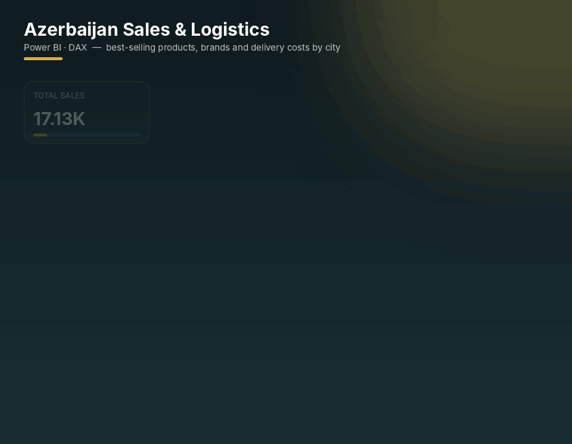
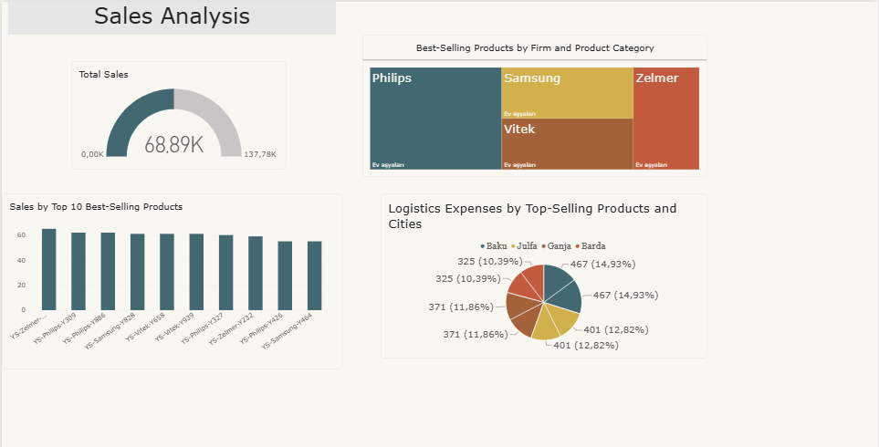

# 🛒 Azerbaijan Sales & Logistics Dashboard

  

*Which products sell best, which firms and categories drive revenue, and how much does it cost to deliver them across Azerbaijani cities?*

## 📸 Dashboard

🔍 View full-resolution static screenshot

 

---

## ❓ Business questions

- What are the top 10 best-selling products?
- Which firms and product categories generate the most sales?
- How are logistics costs distributed across cities (Baku, Ganja, Barda, Julfa…)?
- What is the total sales volume?

## 🗂 Data

Sales transactions with **firm, product, category, city, sales amount (AZN), sales quantity** and **logistics cost**.

## 📊 What's inside

- **Sales by Top 10 Best-Selling Products** — column chart
- **Best-Selling Products by Firm and Category** — treemap
- **Logistics Expenses by Top-Selling Products and Cities** — pie chart
- **Total Sales** — gauge KPI

## 🔢 Headline KPIs

| Total sales | Brands | Cities |
|:-:|:-:|:-:|
| **68.89K** | **Philips · Samsung · Vitek · Zelmer** | **Baku · Ganja · Barda · Julfa** |

## 💡 Key insights

- **Philips** is the strongest brand in the home-appliances category, followed by **Samsung** and **Vitek**.
- The top 10 products sell at a very similar level (≈55–65 units each), so revenue is not dependent on a single product.
- Logistics costs are spread fairly evenly: **Baku** and **Julfa** carry the largest share (≈15% and ≈13% per top product), **Barda** the smallest (≈10%).

## 🧠 Skills demonstrated

- Top-N filtering
- Combining revenue and cost views to spot unprofitable delivery routes
- Regional analysis for the Azerbaijani market

---

## 🚀 How to open

1. Install [Power BI Desktop](https://www.microsoft.com/power-platform/products/power-bi/desktop) (free).
2. Download **`azerbaijan-sales-logistics-dashboard.pbix`** from this repository.
3. Open it in Power BI Desktop and interact with the slicers and visuals.

---

Built by <a href="https://github.com/Ali-Isa-Ashrafli"><b>Ali Isa Ashrafli</b></a> · Data Analyst · Baku, Azerbaijan 
⭐ If you find this project useful, consider giving it a star!

